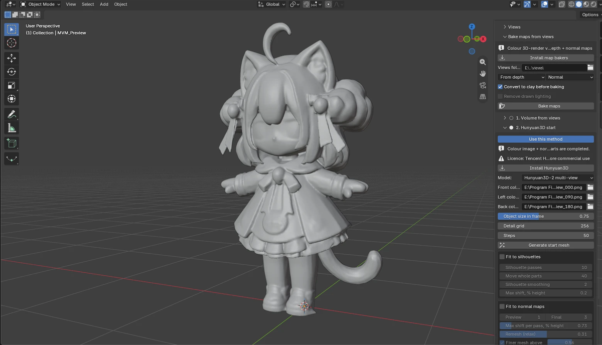

# Multiview Modeler

A Blender add-on that automates building a dense 3D mesh of a character or object from multi-view images. It covers the steps between "I have eight views" and "I have a clean, high-resolution mesh in Blender": baking depth and normal maps from ordinary colour views, building the volume, fitting the surface to every view at once, and cleaning the result. Retopology is deliberately out of scope and meant for a separate tool.

## What it does

- **Bakes maps from views.** Depth Anything V2 (depth) and Marigold (normals), or normals derived from depth, with axis and scale checks against the silhouettes. Optional clay conversion and de-lighting to reduce noise from painted colour and lighting.
- **Builds the mesh by one of three methods**, chosen by you (there is no automatic method switching):
  1. *Volume from views*: silhouettes and normal maps of all views, then a fit to every map at once.
  2. *Hunyuan3D start*: a neural start mesh from a colour image (Hunyuan3D 2.0 shape model), aligned and fitted to your views.
  3. *Depth + normals*: depth and normal map of every view, fused into a volume with sub-voxel surface extraction.
- **Cleans the result.** Trims geometry that sticks out of the view silhouettes without opening holes, removes floating pieces only when they are proven junk, and reports open edges and separate parts. Works in the live preview and in the final build.
- **Live preview and final build** with progress reporting, a reset button for every method, and a cache-clearing button for downloaded models and temporary files.

The heavy computation runs in separate processes (CPU for the fit, GPU for the neural parts), so Blender stays responsive and its own Python is never modified.

## Example

A start mesh made with method 2 (Hunyuan3D 2 multi-view, front, left and back colour images), shown in the live preview with the fit to normal maps switched off and the silhouette fit off. This is one result on one test character, not a general guarantee.

## Requirements

- Blender 3.6 or newer is declared by the add-on; it has been tested only with Blender 5.2 on Windows 11.
- For the neural parts (map baking, Hunyuan3D): an NVIDIA GPU with CUDA. Developed on an RTX 4070 (12 GB).
- Disk space: about 150 MB for the core dependencies; about 6 GB more for the neural environment and model weights if you use them.

## Installation

1. Zip the `multiview_modeler` folder (the folder itself must be at the top level of the archive), or download a release archive.
2. Blender: Edit → Preferences → Add-ons → ▾ → *Install from Disk*, pick the zip and enable "Multiview Modeler".
3. Sidebar (N) → **Multiview** tab → **Install dependencies**.

The full manual, with every setting explained, is in [`multiview_modeler/README.md`](multiview_modeler/README.md).

## Measured results

All numbers come from one test character (a reference mesh used as ground truth) and are given as the mean surface error in percent of the character height. They show what was measured on that one character, not a general guarantee.

| Input | Method | Mean error |
|---|---|---|
| Exact maps rendered from the reference mesh | Depth + normals, grid 256 | 0.21 % |
| Maps baked by Depth Anything V2 + Marigold from colour views | Volume from views | 0.95 % |
| The same baked maps | Depth + normals, max carve 3 % | 1.08 % (3.1 % without the limit: thin parts get carved away) |
| Mesh from the Hunyuan3D 2.0 web demo (one image) | after best-fit scale and rotation | 1.11 % |

Notes on honesty:
- The baked maps are guessed by neural networks per view; depth is off by 2.4–6 % of height and normals by 13–21°. The multi-view constraints are what keeps the result close.
- The Hunyuan3D integration inside the add-on has **not** been measured yet; the figure above is for a mesh made in the web demo and compared to the same reference.
- The reference mesh is itself machine-generated, so "error" means "distance to that mesh".
- Image generators cannot draw physically consistent shading or exact view angles, so views drawn by an AI need checking; the companion workflow uses clay-style renders for that reason.

## Known limitations

- Surfaces that no view sees are completed smoothly or by the neural start, not measured.
- Thin parts can be lost by the depth-based method when maps are inaccurate.
- Input views must agree with each other.
- Tested on Windows with one GPU and one test character. Linux and macOS are untested; macOS has no CUDA.
- Not a retopology tool.

## Licences

The add-on source code in this repository is released under the **GNU General Public License v3.0 or later** (see [`LICENSE`](LICENSE)). Blender add-ons that use the `bpy` API are expected to be GPL-compatible, which is why this licence was chosen.

The add-on does **not** bundle any model or third-party library. On demand it downloads models and installs packages that carry **their own licences, some of them restricted**:

- Hunyuan3D 2.0: Tencent Hunyuan 3D 2.0 Community License (not valid in the EU, UK and South Korea; extra conditions apply)
- Depth Anything V2 Large: CC BY-NC 4.0
- Marigold normals v1.1: Open RAIL++-M for the weights (the Marigold code is Apache-2.0)

Read [`THIRD_PARTY.md`](THIRD_PARTY.md) before using the output commercially.
